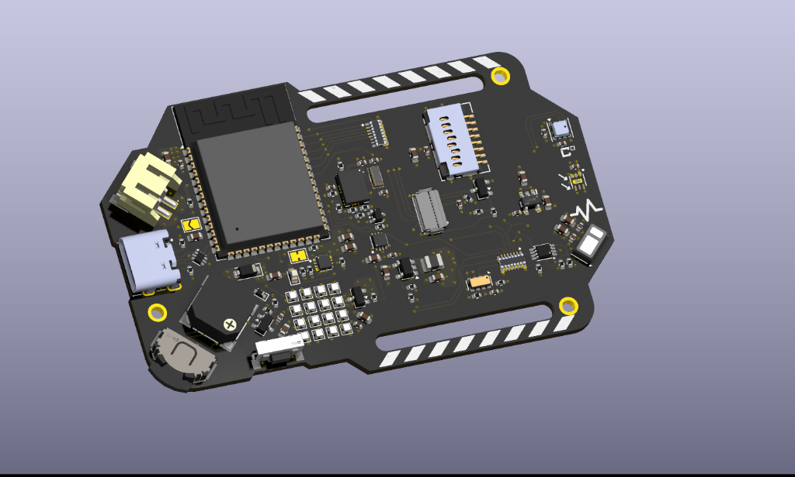
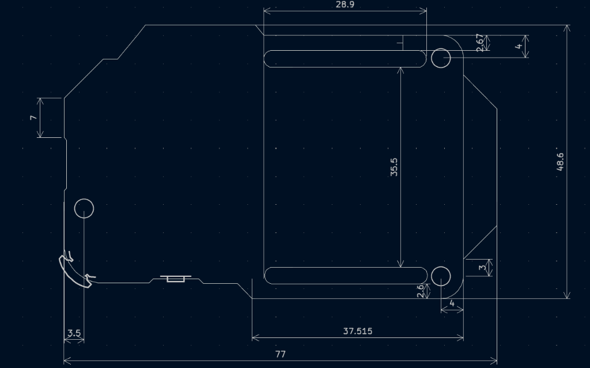
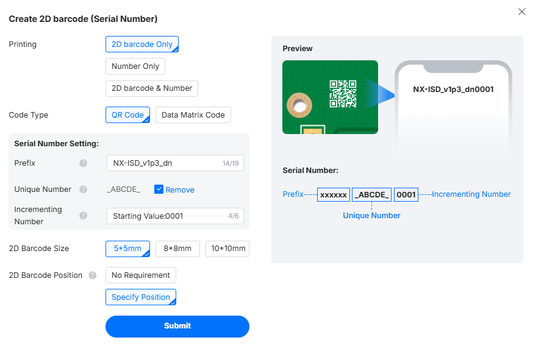
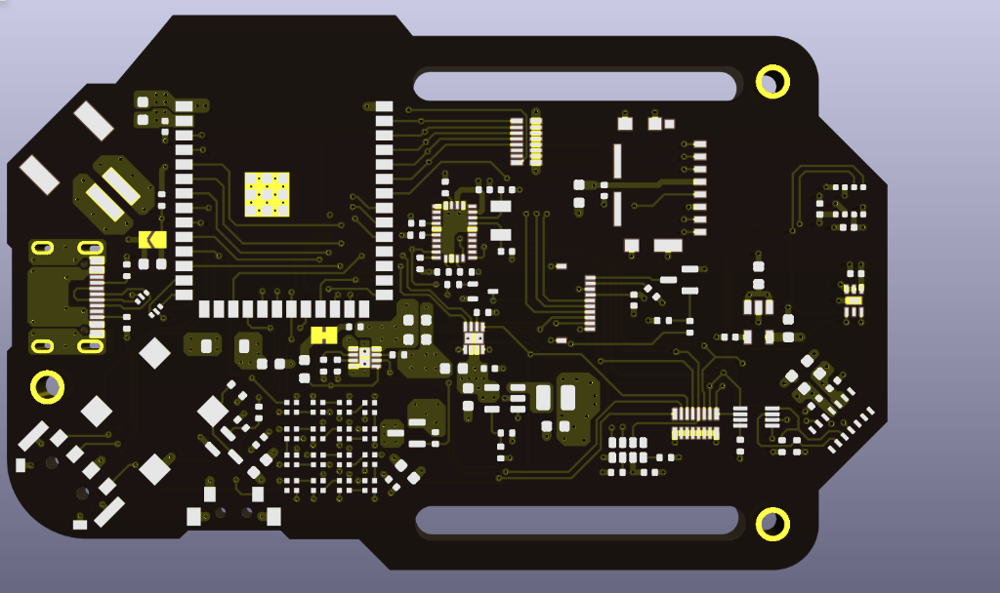
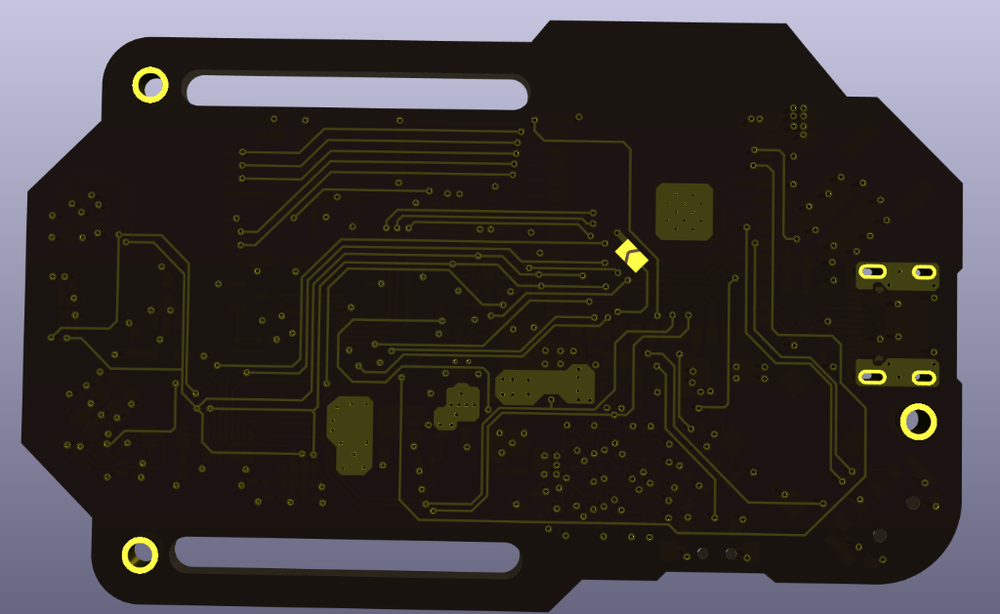

# NX-ISD Hardware Production & Fabrication Guide (v1.4)

This guide contains the complete manufacturing parameters, mechanical specifications, SMD stencil settings, and recommended assembly workflow for fabricating the **NX-ISD v1.4** PCB.

  

---

## 1. Mechanical Dimensions & Outline

  

| Dimension | Specification | Notes |
| :--- | :--- | :--- |
| **Total Length** | `77.00 mm` | Outer envelope edge-to-edge |
| **Total Width** | `48.60 mm` | Outer envelope edge-to-edge |
| **Board Thickness** | `1.2 mm` | Recommended range: `1.2 mm` to `1.6 mm` (1.2 mm ideal for wearables) |
| **Strap Slot Width** | `28.90 mm` | Accepts up to 28 mm standard wrist straps |
| **Strap Slot Spacing** | `35.50 mm` | Inner spacing between upper and lower strap slots |
| **Lower Body Flat** | `37.515 mm` | Straight datum edge along the bottom chassis |
| **USB-C Port Notch** | `7.00 mm` | Outer edge recess for USB-C cable hood clearance |
| **Mounting Holes** | 3× Plated Holes | Standard M2 / M2.5 clearance holes |
| ↳ Left Hole Offset | `3.50 mm` | Distance from left edge to hole center |
| ↳ Right Hole Offsets | `4.00 mm` / `2.60 mm` | Distance from outer edges & strap slot corners |

---

## 2. PCB Fabrication Settings (JLCPCB)

> [!TIP]
> **Ready-to-Order Fabrication Files (v1.4):**  
> 📦 **Gerber Archive:** [`NX-ISD_v1p4/production/NX-ISD_v1p4.zip`](NX-ISD_v1p4/production/NX-ISD_v1p4.zip) (Complete RS-274X Gerbers and Excellon drill files)  
> 📋 **Production BOM:** [`NX-ISD_v1p4/production/bom.csv`](NX-ISD_v1p4/production/bom.csv)  
> 📍 **Component Placement (CPL):** [`NX-ISD_v1p4/production/positions.csv`](NX-ISD_v1p4/production/positions.csv)

When ordering from [JLCPCB](https://jlcpcb.com/) (or another high-spec PCB house), upload `NX-ISD_v1p4.zip` and configure the following parameters:

| Setting | Value | Requirement Level | Notes |
| :--- | :--- | :--- | :--- |
| **Layers** | `4 Layers` | **Mandatory** | Layer stack: `F.Cu`, `In1.Cu` (GND), `In2.Cu` (Power/3V3), `B.Cu` |
| **PCB Thickness** | `1.2 mm` | **Recommended** | `1.2 mm` provides optimal weight and stiffness for wrist wear |
| **Material Type** | `FR4-TG155` | **Important** | High glass transition temperature prevents delamination during reflow |
| **Surface Finish** | `ENIG` | **Mandatory** | Flat gold finish is essential for 0402 passives, WSON, and 0.4mm pitch ICs |
| **Gold Thickness** | `1 U"` | Standard | Standard 1 micro-inch immersion gold |
| **Min Via Hole / Diameter**| `0.25 mm / 0.45 mm`| Standard | Thermal pad vias set to 0.45mm diameter to avoid micro-drill surcharges |
| **Copper Weight** | `1 oz` (35 µm) | Standard | 1 oz outer / 1 oz inner |
| **PCB Color / Mask** | `Black` / `Matte Black` | Aesthetic | Black matches the cyberpunk aesthetic |
| **Silkscreen Color** | `White` | Standard | High-contrast white silkscreen |
| **Impedance Control** | `No` | Standard | Standard 4-layer stackup |
| **Mark on PCB** | `2D Barcode (Serial)` | Optional | See detailed configuration below |
| **Flying Probe Test** | `Fully Tested` | **Recommended** | Verifies 100% net continuity before shipping |

### 2.1 2D Barcode (Serial Number) Configuration

If you select **"Mark on PCB: 2D barcode (Serial Number)"** on JLCPCB, use the following settings:

  

* **Printing:** `2D barcode Only`
* **Code Type:** `QR Code`
* **Prefix:** `NX-ISD_v1p4_dn` (or preferred revision prefix)
* **Unique Number:** Check `Remove`
* **Incrementing Number:** `Starting Value: 0001`
* **2D Barcode Size:** `5*5 mm`
* **2D Barcode Position:** `Specify Position` (place on bottom silkscreen in unpopulated area)

---

## 3. SMD Stencil Specifications

All active SMD components are placed on the **Top layer** (`F.Cu`), meaning only a single-sided top stencil is needed.

| Parameter | Specification | Notes |
| :--- | :--- | :--- |
| **Stencil Side** | `Top only` | No bottom SMD components require solder paste |
| **Stencil Dimensions** | `100 mm × 100 mm` (Custom) | Frameless custom size is compact and fits desktop mini-hotplates |
| **Thickness** | `0.10 mm` (100 µm) | 100 µm thickness provides optimal paste volume for 0402 & fine-pitch QFN |
| **Polishing Process** | `Electropolishing` | **Important!** Guarantees clean paste release from tiny 0402 & 1010 LED apertures |
| **Fiducials** | `None` / `Half-etched` | Standard manual alignment |

---

## 4. Component Sourcing

All components can be sourced from major distributors:
- **LCSC:** Passive resistors, capacitors, diodes, LEDs, and standard ICs (very cost-effective).
- **Mouser / DigiKey:** Specialized sensors (BNO085 IMU, OPT3001, MAX17048, BQ25170, TPS62840).

> [!TIP]
> **Solder Paste Selection:** Use high-quality **Sn63/Pb37** (leaded, $\approx 183^\circ\text{C}$ melting point) or **SAC305** (lead-free, $\approx 217^\circ\text{C}$) in **Type 4 or Type 5** particle size. Type 4/5 paste flows much cleaner through the tiny stencil apertures for 0402 and 1010 RGB LEDs.

---

## 5. Assembly & Reflow Workflow

> [!WARNING]
> **Advanced Assembly Complexity:** This PCB contains high-density 0402 passives, 0.4mm/0.5mm pitch WSON packages with thermal pads, and sixteen 1.0×1.0 mm RGB LEDs. Proper equipment (microscope and temperature-controlled hotplate/oven) is strongly recommended.

### Recommended Equipment:
1. **Reflow Heat Source:**
   - **Mini Hotplate:** e.g., Miniware MHP50 or MHP30 with 100W USB-C PD supply.
   - **Reflow Oven:** Dedicated hobby oven or T-962 with custom firmware.
2. **Inspection:** Stereo microscope or high-definition digital microscope.
3. **Tools:** Ultra-fine curved ESD tweezers, stainless steel solder paste squeegee, flux pen, and solder wick.
4. **Jig:** 3D-printed PCB alignment holder to clamp the stencil firmly against the PCB during pasting.

### Step-by-Step Assembly Sequence:

1. **Solder Paste Stenciling:**
   - Secure the bare PCB in the 3D-printed jig.
   - Align the electropolished stencil apertures precisely over the gold pads.
   - Deposit a bead of paste along one edge and swipe once with the squeegee at a 45° angle.
   - Lift the stencil vertically without dragging.
2. **Component Placement (Small to Big):**
   - **Step A:** Place all 0402 resistors and capacitors first.
   - **Step B:** Place the small ICs (`U3`, `U5`, `U6`, `U7`, MOSFETs, diodes).
   - **Step C:** Place the **4×4 NeoPixel Matrix** (16× `XL-1010RGBC-WS2812B`).
     > [!IMPORTANT]
     > **NeoPixel Alignment:** Align the physical green corner marking on the LED package directly with the **white silkscreen triangle on Pin 3 (GND)**.
   - **Step D:** Place the MicroSD socket (`105162-0001`), display FPC connector (`J2`), and ESP32-S3 module.
3. **Reflow Soldering:**
   - Place board on preheated hotplate (ramp to $\approx 150^\circ\text{C}$ soak for 60s, then bump to $210\text{–}230^\circ\text{C}$ peak for 20–30s until all joints liquify).
   - Carefully remove and allow to cool naturally.
4. **Post-Reflow Inspection & Touch-up:**
   - Inspect under microscope for any micro-bridges on fine-pitch IC pins (`MAX17048`, `BQ25170`, SD card socket pads).
   - Touch up with flux pen and a micro-chisel soldering tip or hot air if needed.
5. **Through-Hole Connectors & Hardware:**
   - Hand-solder through-hole connector anchors (USB-C shield wings `SH1`–`SH4`, battery connector pads, tactile lever button, and rotary/button inputs).

---

## 6. Board Layer Views (v1.4)

  
  

