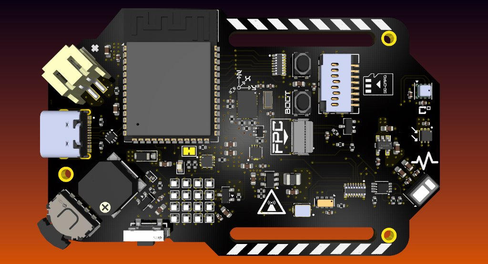
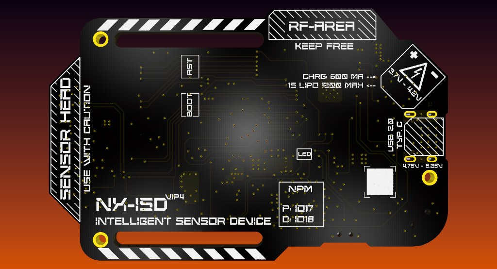
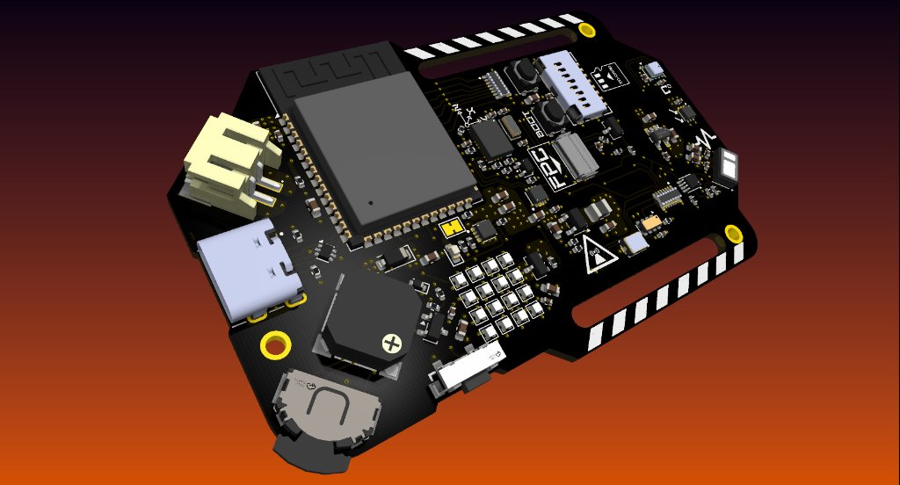
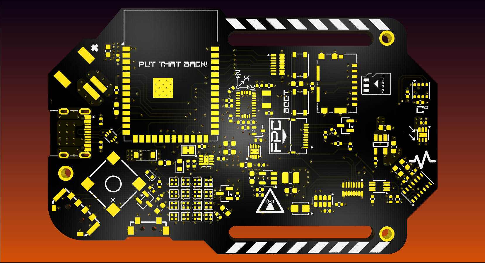

# NX-ISD Hardware Specification (Revision v1p4 - Current & Recommended)

This directory contains the schematic design, PCB layout, fabrication outputs, and Bill of Materials (BOM) for the **NX-ISD** (Intelligent Sensor Device) wearable carrier board.

<p align="center">
  
  
</p>
<p align="center">
  
  
</p>
<p align="center">
  <em>NX-ISD Hardware Revision v1p4 (KiCad Raytraced 3D Renders) — Populated Top View, Bottom Silkscreen, Perspective Isometric Angle, and Bare ENIG Finish with "PUT THAT BACK!" Silkscreen Easter Egg</em>
</p>

> [!TIP]
> **Production & Ordering Guide (v1.4):** For complete mechanical drawings, JLCPCB ordering parameters, SMD stencil specs, and hand assembly tips, see the **[Production Guide](PRODUCTION-GUIDE.md)**.  
> 📦 **Latest v1.4 Fabrication Package:** [`NX-ISD_v1p4/production/NX-ISD_v1p4.zip`](NX-ISD_v1p4/production/NX-ISD_v1p4.zip) (Ready for JLCPCB / PCBWay).  
> 📜 **Latest v1.4 Circuit Diagram (5 Sheets):** [`../docs/circuit diagrams/NX-ISD_v1p4.pdf`](../docs/circuit%20diagrams/NX-ISD_v1p4.pdf).

---

## 1. Board Specifications & Physical Dimensions

| Parameter | Specification | Notes |
| :--- | :--- | :--- |
| **Dimensions** | **77.00 mm × 48.60 mm** | Measured outer bounding box on `Edge.Cuts` |
| **Board Thickness** | **1.2 mm** | Standard FR-4 rigid substrate (optimal wrist comfort & rigidity) |
| **Layer Count** | **4 Layers** | Optimized signal integrity, unbroken GND plane, and dedicated power pours |
| **Copper Weight** | 1 oz Outer (35 µm), 1 oz Inner | Standard manufacturing yield with thermal relief |
| **Surface Finish** | ENIG (Electroless Nickel Immersion Gold) | Mandatory for fine-pitch QFN/WSON sensors and 0402 passives |
| **Strap Mounts** | Dual integrated strap slots | Accommodates standard 20 mm – 28 mm watch straps |
| **Antenna Clearance** | Dedicated bottom keep-out zone | `RF-AREA KEEP FREE` silkscreen below ESP32-S3 PCB antenna |
| **Primary Connector** | 16-Pin Mid-Mount USB Type-C | USB 2.0 Full Speed + 5V 600mA charging |
| **Battery Header** | JST PH 2.0mm 2-Pin (`J2`) | Polarized 1S LiPo (1200 mAh form factor) |
| **Mass Storage** | Push-Pull MicroSD Socket (`J4`) | High-speed 4-bit SDMMC bus interface |

### 4-Layer PCB Stackup

```text
┌────────────────────────────────────────────────────────────────────────┐
│ Layer 1: Top (F.Cu)       High-density signal routing, IC pads, GND    │
├────────────────────────────────────────────────────────────────────────┤
│ Layer 2: Inner 1 (In1.Cu) Solid uninterrupted Ground Plane (GND)       │
├────────────────────────────────────────────────────────────────────────┤
│ Layer 3: Inner 2 (In2.Cu) Power Planes (+3V3, VBAT, +1V8, VN)          │
├────────────────────────────────────────────────────────────────────────┤
│ Layer 4: Bottom (B.Cu)    Secondary routing, thermal pads, silkscreen  │
└────────────────────────────────────────────────────────────────────────┘
```

---

## 2. Power Architecture & Voltage Domains (v1.4)

```text
               ┌───────────────────────┐
  USB-C (5V) ─►│ BQ25170 Charger (U3)  ├──► VBAT (3.7V - 4.2V, 1S LiPo via J2)
               │ (600mA, 10k NTC TH1)  │         │
               └───────────────────────┘         ├─► MAX17048 Fuel Gauge (U6)
                                                 │
  ┌──────────────────────────────────────────────┘
  │
  ├──► TLV62568 Buck Converter (U4) ──► +3V3 (System Rail, ~95% Efficiency)
  │    (2.2µH L1, 10µF filtering)         │
  │                                       ├─► ESP32-S3 Microcontroller (U2)
  │                                       ├─► BNO085 9-DOF IMU (U11)
  │                                       ├─► BME690 Environmental (U7)
  │                                       ├─► OPT3001 Ambient Light (U10)
  │                                       ├─► RV-3028-C7 RTC (U12)
  │                                       ├─► MicroSD Card Slot (J4)
  │                                       ├─► ST7789 IPS Display Logic & Backlight (J3 / Q4)
  │                                       └─► Buzzer LS1 (via Q3)
  │
  ├──► RT9193-18GB LDO (U5) ──────────► +1V8 (Ultra-Low-Noise Sensor Rail)
  │    (Ultra-Low Noise, 300mA)           ├─► MAX30102 PPG / Biometrics (U8)
  │                                       └─► PCA9306 I2C Level Shifter (U9, Port 1)
  │
  ├──► DMP3130L-7 PMOS Gate (Q1) ──────► VN   (Switched VBAT Rail, 3.0V - 4.2V)
  │    (Driven by IO17 via BC847W)        └─► 16x NeoPixel Matrix (G1..G16)
  │                                           [Guarantees 0µA sleep draw]
  │
  └──► RV-3028-C7 Internal Charger ───► VBACKUP (Autonomous Supercapacitor Rail)
       (Switch + Schottky + 3k Ladder)    └─► 11mF 3.3V Seiko CPH3225A (C5)
                                              [~6.2 Days RTC timekeeping backup]
```

### Voltage Rail Details

| Rail | Nominal Voltage | Regulator / Source | Max Current | Consumers |
| :--- | :--- | :--- | :--- | :--- |
| **`VBUS`** | 5.0 V (4.75–5.25V) | USB Type-C Receptacle (`J1`) | 1.5 A | BQ25170 Charger, USB detect divider, USBLC6 ESD |
| **`VBAT`** | 3.7 V (3.0–4.2V) | 1S LiPo via JST PH (`J2`) | 2.0 A peak | Buck converter, LDO, Fuel Gauge, VN PMOS switch, Power-Path PMOS (`Q2`) |
| **`+3V3`** | 3.3 V (±1.5%) | TLV62568DBVR Synchronous Buck (`U4`)| 1.0 A | ESP32-S3, BNO085, BME690, OPT3001, RV-3028, MicroSD, ST7789 Display, Buzzer |
| **`+1V8`** | 1.8 V (±2.0%) | RT9193-18GB Low-Noise LDO (`U5`) | 300 mA | MAX30102 logic core, PCA9306 level shifter low-side |
| **`VN`** | Switched `VBAT` | DMP3130L-7 High-Side PMOS (`Q1`) | 1.0 A | 16x XL-1010RGBC NeoPixels (0µA cutoff when unpowered) |
| **`VBACKUP`**| 3.3 V max (1.1–3.05V)| RV-3028-C7 Internal Trickle Charger| 1.0 mA chg | Pin 6 of RV-3028-C7 backed by $11\text{ mF}$ CPH3225A Supercap (`C5`) |

---

## 3. Power Consumption Budget & Battery Calculation

Comprehensive current consumption analysis across operating states, accounting for conversion efficiencies and real-world loads:

### 1. Subsystem Current Breakdown

#### A. 16× NeoPixel RGB Matrix (`G1`–`G16`, on Switched `VN` / `VBAT`)
* **Driver Constant-Current Sink:** $5.0\,\text{mA}$ per color channel (R, G, B).
* **Per LED at 100% White:** $(3 \times 5.0\,\text{mA}) + 0.35\,\text{mA}$ (internal logic) $\approx \mathbf{15.35\,\text{mA}}$.
* **100% White Matrix Stress Test (16 LEDs):** $16 \times 15.35\,\text{mA} \approx \mathbf{245.6\,\text{mA}}$ (drawn directly from `VBAT` through PMOS `Q2`).
* **Dynamic Cyberpunk Animations (`CYBER RADAR`, `NEON TRACER`, etc.):** 2 to 5 active LEDs at 30–60% intensity $\approx \mathbf{15\text{ to }35\,\text{mA}}$ average.
* **Standby / Off State (`PWR_NPM` = LOW):** High-side PMOS `Q2` is gated off by pull-up $\implies \mathbf{0.00\,\mu\text{A}}$ (completely eliminates NeoPixel quiescent leakage).

#### B. ESP32-S3 Dual-Core Microcontroller (`U13`, on `+3V3`)
* **Active Wi-Fi TX (Max power + Dual-Core processing):** $\approx 240\text{ to }350\,\text{mA}$ (transient peaks up to $\approx 450\,\text{mA}$).
* **Active BLE Connected / Advertising:** $\approx 35\text{ to }55\,\text{mA}$.
* **Normal Dual-Core Processing (No RF, 240 MHz):** $\approx 40\text{ to }65\,\text{mA}$.
* **Frequency-Scaled Run (80 MHz / 160 MHz):** $\approx 20\text{ to }35\,\text{mA}$.
* **FreeRTOS Light-Sleep (Between 50Hz/1Hz sensor ticks):** $\approx 1.5\text{ to }3.0\,\text{mA}$.
* **Deep-Sleep (ULP / RTC wake only):** $\approx 15\text{ to }25\,\mu\text{A}$.

#### C. ST7789 IPS Display (`J2`, on `+3V3` & `+2V8`)
* **Backlight LEDs (via `+3V3` switched by N-MOSFET `Q4`):**
  * 100% Brightness: $\approx 35\text{ to }45\,\text{mA}$.
  * 40% Indoor Brightness: $\approx 15\text{ to }20\,\text{mA}$.
* **Display Controller Logic (via `+2V8` LDO `U4`):** $\approx 5\text{ to }10\,\text{mA}$.
* **Display Sleep Mode (`SLPIN` command):** $< 20\,\mu\text{A}$.
* **Total Display Active:** $\approx 20\text{ to }55\,\text{mA}$.

#### D. Sensors, Audio & Storage Peripherals
* **MAX30102 Biometrics (`U8`, on `+1V8` LDO `U1`):**
  * Time-averaged optical pulse current (Red + IR LEDs @ 50–100 Hz): $\approx 10\text{ to }18\,\text{mA}$ (peaks of $50\,\text{mA}$ during $400\,\mu\text{s}$ pulses).
  * Standby / Shutdown: $< 1\,\mu\text{A}$.
* **BNO085 9-DOF IMU (`U11`, on `+3V3`):**
  * Active 9-axis sensor fusion (internal ARM Cortex-M0+ running at 100 Hz): $\approx 15\text{ to }18\,\text{mA}$.
  * Low-power tap / step-detector only: $\approx 0.8\text{ to }1.5\,\text{mA}$.
* **BME690 Environmental (`U7`, on `+3V3`):**
  * Base climate sampling (T/P/H): $< 1\,\text{mA}$.
  * MOX Gas Heater Pulse (heats to $320^\circ\text{C}$ for $\approx 30\,\text{ms}$): $\mathbf{+12\text{ to }14\,\text{mA}}$ transient burst.
* **B1 Electromagnetic Buzzer (`B1`, on `+3V3` via `Q3`):**
  * $16\,\Omega$ coil impedance at $3.3\,\text{V}$: Peak current $\approx 206\,\text{mA}$.
  * 50% PWM Duty Cycle acoustic tone: $\approx \mathbf{80\text{ to }100\,\text{mA}}$ average (only when sounding alert/alarm).
* **ZDSD02GLGEAG SPI NAND Flash (`U14`, on `+3V3`):**
  * Standby: $\approx 10\,\mu\text{A}$.
  * High-speed SPI Read/Write bursts: $\approx 15\text{ to }25\,\text{mA}$.
* **OPT3001 Ambient Light (`U10`, on `+3V3`):** $\approx 2\text{ to }4\,\mu\text{A}$ (quiescent).
* **RV-3028-C7 RTC (`U12`, on `+3V3`):** $\approx 45\,\text{nA}$ (running continuously).
* **LDO Quiescent Currents (`U1`, `U4`):** $\approx 90\,\mu\text{A}$ each.

---

### 2. Supply Rail Power Budget & Buck Efficiency

#### `+3V3` System Rail (TLV62568 Synchronous Buck `U3`):
* **Normal Operation (Display on, sensors active, Wi-Fi off):** $\approx 80\text{ to }130\,\text{mA}$.
* **Full Load (Wi-Fi TX active, display 100%, all sensors active, BME690 heater):** $\approx \mathbf{320\text{ to }460\,\text{mA}}$.
* **Absolute Worst-Case Transient (+ Buzzer beeping):** $\approx 550\text{ to }640\,\text{mA}$.
* **Regulator Headroom:** TLV62568 is rated for **$1.0\,\text{A}$** continuous current $\implies$ **$> 35\%\text{--}50\%$ thermal and electrical safety margin** under simultaneous peak load.

#### Effective Battery Draw (from 1S LiPo, $V_{\text{BAT}} \approx 3.7\,\text{V}$):
The TLV62568 buck operates at $\approx 90\text{--}95\%$ efficiency ($\eta$):
$$P_{\text{in}} = \frac{V_{\text{out}} \times I_{\text{out}}}{\eta} \implies I_{\text{BAT,buck}} \approx \frac{3.3\,\text{V} \times I_{\text{3V3}}}{3.7\,\text{V} \times 0.92} \approx 0.97 \times I_{\text{3V3}}$$

* **Buck Current from Battery:** $\approx 310\text{ to }445\,\text{mA}$ (during Wi-Fi TX).
* **Matrix Current from Battery:** $\approx 245\,\text{mA}$ (100% white stress test).
* **LDOs from Battery (+1V8 and +2V8):** $\approx 15\text{ to }25\,\text{mA}$.
* **Total Battery Current at 100% Synthetic Stress Test:** $\mathbf{\approx 570\text{ to }715\,\text{mA}}$ (short peaks up to $\approx 780\,\text{mA}$ with buzzer).
* **Battery Health Assessment:** On a **1200 mAh 1S LiPo**, $715\,\text{mA}$ represents a discharge rate of only $\approx \mathbf{0.6\text{ C}}$ (standard 1S LiPo cells tolerate $1.0\text{ C}$ continuous / $2.0\text{ C}$ pulse), ensuring zero risk of excessive cell heating or premature degradation.

---

### 3. Realistic Operating Profiles & Expected Battery Life (1200 mAh LiPo)

| Profile | Description / Active Subsystems | Average Battery Current | Estimated Runtime |
| :--- | :--- | :--- | :--- |
| **Profile 1: Synthetic Stress Test** | 100% White Matrix, Wi-Fi TX active, Display 100%, all sensors | $\approx 650\,\text{mA}$ | **$\approx 1.8\text{ Hours}$** |
| **Profile 2: Continuous "Cyberpunk" Active** | Display 60% (~18mA), 4×4 Matrix dynamic animation (~25mA), BNO085 fusion, PPG pulse, BLE advertising | $\approx 95\text{ to }130\,\text{mA}$ | **$\approx 9\text{ to }12.5\text{ Hours}$** (Continuous screen-on) |
| **Profile 3: Daily Smartwatch Wear** | Display auto-off after 10s, Matrix off, Raise-to-wake active (BNO085), background pedometer & climate logging, periodic BLE sync | $\approx 15\text{ to }25\,\text{mA}$ | **$\approx 48\text{ to }80\text{ Hours}$** (2 to 3.5 Days) |
| **Profile 4: Low-Power Standby / Sleep** | Screen & Matrix off ($0\,\mu\text{A}$), ESP32 light-sleep, RTC active, low-power sensor interrupt monitoring | $\approx 2.0\text{ to }3.5\,\text{mA}$ | **$\approx 340\text{ to }600\text{ Hours}$** (14 to 25 Days) |
| **Profile 5: Shelf Storage (Deep-Sleep)** | Display unpowered, Matrix unpowered, ESP32 deep-sleep, RV-3028 RTC running | $< 35\,\mu\text{A}$ | **$> 3\text{ Years}$** |

---

## 4. Primary Component & IC Roster (v1.4)

| Designator | Component | Package | Function | Sourcing / LCSC # |
| :--- | :--- | :--- | :--- | :--- |
| **U2** | **ESP32-S3-WROOM-1-N16R8** | Module (18×25.5 mm) | Dual-Core 240MHz MCU, 16MB Flash, 8MB PSRAM | Direct / Espressif |
| **U4** | **TLV62568DBVR** | SOT-23-5 | Synchronous Step-Down DC-DC Buck Converter (+3V3) | C967888 |
| **U3** | **BQ25170DSGR** | WSON-8 (2×2 mm) | 800mA Linear LiPo Charger with 10k NTC & thermal pour | C2837330 |
| **U6** | **MAX17048G_T10** | TDFN-8 (2×2 mm) | ModelGauge™ LiPo Fuel Gauge with ALERT output | C2682619 |
| **U5** | **RT9193-18GB** | SOT-23-5 | 300mA Ultra-Low-Noise LDO (+1.8V Sensor Rail) | C27416 |
| **U11** | **BNO085** | LGA-28 (5.2×3.8 mm) | 9-DOF Motion Co-Processor (dedicated 32.768kHz crystal Y1)| Direct / CEVA |
| **U7** | **BME690 / BME680** | LGA-8 (3×3 mm) | Temperature, Relative Humidity, Pressure, Gas MOX | Direct / Bosch |
| **U8** | **MAX30102** | OLGA-14 (3.3×5.6 mm) | Pulse Oximetry ($SpO_2$) & Heart Rate Optical Sensor | C83038 |
| **U9** | **PCA9306DCKR** | VSSOP-8 | Dual Bidirectional I2C Voltage-Level Translator (1.8V ↔ 3.3V) | C7570 |
| **U10** | **OPT3001DNPR** | USON-6 (2×2 mm) | Precision Ambient Light Sensor (Photopic curve) | C113886 |
| **U12** | **RV-3028-C7** | SON-8 (1.5×3.2 mm) | Ultra-Low Power RTC (45nA) with internal trickle charger | C2838382 |
| **C5** | **CPH3225A** | 1210 SMD (3.2×2.5 mm)| 11mF 3.3V Rechargeable Supercapacitor (VBACKUP) | Seiko Instruments |
| **U1** | **USBLC6-2SC6** | SOT-23-6 | Ultra-Low Capacitance Rail-to-Rail ESD Protection | C7519 |
| **G1..G16**| **XL-1010RGBC-WS2812B** | 1010 SMD (1×1 mm) | 16x NeoPixel Serpentine 4×4 RGB Matrix | C5349953 |
| **SW3** | **TM-2025A** | SMD Multi-Way | Multi-Directional Navigation Lever-Switch | C318949 |
| **SW4** | **TS-1101VS-C-A-A** | SMD Button | Tactile Push Button (Main user interaction) | C318884 |
| **SW1, SW2**| **TS18-5-15-SL-260-SMT-TR**| SMD Button | Dedicated Tactile Hardware Reset (RST) & Bootloader (BOOT) | TS18 |
| **LS1** | **SMD-8503-3627-16Ω** | SMD (8.5×8.5 mm) | Electromagnetic Buzzer with flyback protection | C2685545 |
| **J1** | **UJ20-C-H-G-SMT-1-P16**| 16-Pin Mid-Mount | USB Type-C Receptacle with CC1/CC2 5.1k resistors | C2765186 |
| **J2** | **JST S2B-PH-SM4-TB** | 2-Pin SMT PH 2.0mm | Polarized LiPo battery connection header | C2875850 |
| **J3** | **TE 1-2328702-0** | 10-Pin 0.5mm FPC | Dual-contact back-flip FPC connector for ST7789 | C2837335 |
| **J4** | **105162-0001** | Push-Pull MicroSD | MicroSD Card Socket (4-bit SDMMC bus) | Molex / C382346 |
| **Q1, Q2** | **DMP3130L-7** | SOT-23 | -30V P-Channel MOSFETs (NeoPixel power switch & power path) | Diodes Inc. |
| **Q3, Q4** | **ZXMN3B14FTA** | SOT-23 | 30V N-Channel MOSFETs (Buzzer tone & Backlight PWM) | Diodes Inc. |

---

## 5. Hardware Interfaces & Address Map (v1.4)

### I2C Bus (`Wire`, 400 kHz Fast Mode)
* **SDA:** `GPIO 8` (10k pull-up `R18` to `+3V3`)
* **SCL:** `GPIO 9` (10k pull-up `R19` to `+3V3`)

| Device | Designator | 7-Bit Address | Voltage Domain | Hardware Interrupt Line |
| :--- | :--- | :--- | :--- | :--- |
| **MAX17048** | `U6` | `0x36` | `+3V3` | `GPIO 4` (`!ALERT`, active LOW) |
| **OPT3001** | `U10` | `0x44` / `0x45` | `+3V3` | Polled over I2C |
| **BNO085** | `U11` | `0x4A` | `+3V3` | `GPIO 7` (`!INT_DOF`, active LOW) |
| **RV-3028-C7**| `U12` | `0x52` | `+3V3` / `VBACKUP` | `GPIO 6` (`!INT_RTC`, active LOW) |
| **MAX30102** | `U8` | `0x57` | `+1V8` (via PCA9306 `U9`) | `GPIO 5` (`!INT_HR`, active LOW) |
| **BME690** | `U7` | `0x76` | `+3V3` | Polled over I2C |

### Dedicated Display High-Speed SPI Bus (Native 3.3V, up to 40 MHz)
* Direct connection eliminates TXB0106 auto-sensing one-shot oscillation and unlocks full 40 MHz SPI clock rate.

| Signal | GPIO Pin | Function | Notes |
| :--- | :--- | :--- | :--- |
| **TFT_SCK** | `GPIO 38` | SPI Serial Clock | Up to 40 MHz write clock |
| **TFT_MOSI**| `GPIO 39` | SPI Master-Out Data | Command and pixel data |
| **TFT_RS** | `GPIO 21` | Command / Data (DC) | LOW = Command, HIGH = Data |
| **TFT_RST** | `GPIO 40` | Hardware Reset | Active LOW reset pulse |
| **CS_TFT** | `GPIO 48` | TFT Chip Select | Active LOW panel selection |
| **TFT_PWM** | `GPIO 47` | Backlight Brightness | PWM drive to gate of N-MOSFET `Q4` |

### High-Speed Mass Storage (4-Bit SDMMC Bus)
* Directly mapped to the ESP32-S3 internal SDMMC peripheral via GPIO Matrix:

| Signal | GPIO Pin | Function | Notes |
| :--- | :--- | :--- | :--- |
| **SD_CLK** | `GPIO 41` | SDMMC Clock | High-speed clock line |
| **SD_CMD** | `GPIO 43` | SDMMC Command/Response | Bidirectional command line |
| **SD_DAT0**| `GPIO 44` | SDMMC Data Bit 0 | Primary read/write data line |
| **SD_DAT1**| `GPIO 42` | SDMMC Data Bit 1 | 4-bit bus extension |
| **SD_DAT2**| `GPIO 1` | SDMMC Data Bit 2 | 4-bit bus extension |
| **SD_DAT3**| `GPIO 2` | SDMMC Data Bit 3 | 4-bit bus extension (CS in 1-bit SPI fallback) |

---

## 6. Complete GPIO Pinout Matrix (v1.4)

Centralized in [`ISD-Core/src/pins.h`](../ISD-Core/src/pins.h):

| GPIO Pin | Pin Name | Peripheral / Signal | Direction | Electrical Notes |
| :--- | :--- | :--- | :--- | :--- |
| **GPIO 1** | `SD_DAT2` | MicroSD Data Bit 2 | Bi-directional | 4-bit SDMMC bus line |
| **GPIO 2** | `SD_DAT3` | MicroSD Data Bit 3 | Bi-directional | 4-bit SDMMC bus line (CS_SD in 1-bit SPI fallback) |
| **GPIO 4** | `ALERT` | Fuel Gauge Alert | Input | Active LOW interrupt from MAX17048 |
| **GPIO 5** | `INT_HR` | MAX30102 PPG FIFO Ready | Input | Active LOW biometric sample-ready interrupt |
| **GPIO 6** | `INT_RTC` | RV-3028 RTC Alarm/Timer | Input | Active LOW periodic/alarm interrupt |
| **GPIO 7** | `INT_DOF` | BNO085 IMU Motion Wake | Input | Active LOW motion interrupt from IMU |
| **GPIO 8** | `I2C_SDA` | I2C Data Line | Bi-directional | 10k hardware pull-up `R18` to `+3V3` |
| **GPIO 9** | `I2C_SCL` | I2C Clock Line | Output | 10k hardware pull-up `R19` to `+3V3` |
| **GPIO 10** | `BUZZER` | Electromagnetic Buzzer | Output | PWM drive to gate of N-MOSFET `Q3` |
| **GPIO 11** | `BAT_STAT` | BQ25170 Charger Status | Input | LOW = Charging, HIGH/Hi-Z = Charge Complete |
| **GPIO 12** | `USB_DETECT`| USB 5V VBUS Presence | Input | Resistor divider from VBUS (HIGH when plugged in) |
| **GPIO 13** | `BTN` | Main Tactile Push-Button | Input | Active LOW (external pull-up, deep-sleep wake capable) |
| **GPIO 14** | `LEVER_LEFT` | Navigation Lever Left | Input | Active LOW (TM-2025A lever tilted left) |
| **GPIO 15** | `LEVER_PUSH` | Navigation Lever Center | Input | Active LOW (TM-2025A center push button) |
| **GPIO 16** | `LEVER_RIGHT`| Navigation Lever Right | Input | Active LOW (TM-2025A lever tilted right) |
| **GPIO 17** | `PWR_NPM` | NeoPixel Matrix Power Gate | Output | HIGH = Powers ON PMOS `Q1`; LOW = 0µA sleep cutoff |
| **GPIO 18** | `NPM` | NeoPixel Serial Data | Output | 800 kHz single-wire NZR stream to `G1` |
| **GPIO 21** | `TFT_RS` | Display Command / Data | Output | LOW = Command, HIGH = Data |
| **GPIO 38** | `TFT_SCK` | Display SPI Clock | Output | Dedicated 40 MHz SPI clock to ST7789 |
| **GPIO 39** | `TFT_MOSI`| Display SPI Master-Out | Output | Dedicated SPI data to ST7789 |
| **GPIO 40** | `TFT_RST` | Display Hardware Reset | Output | Active LOW hardware reset pulse |
| **GPIO 41** | `SD_CLK` | MicroSD Clock | Output | SDMMC high-speed clock |
| **GPIO 42** | `SD_DAT1` | MicroSD Data Bit 1 | Bi-directional | 4-bit SDMMC bus line |
| **GPIO 43** | `SD_CMD` | MicroSD Command/Response| Bi-directional | SDMMC command line |
| **GPIO 44** | `SD_DAT0` | MicroSD Data Bit 0 | Bi-directional | SDMMC primary data line |
| **GPIO 47** | `TFT_PWM` | Display Backlight PWM | Output | Drives gate of N-MOSFET `Q4` (active HIGH) |
| **GPIO 48** | `CS_TFT` | Display Chip Select | Output | Active LOW display selection |

---

## 7. Manufacturing & Assembly Resources

* **Fabrication & Assembly Guide:** [`PRODUCTION-GUIDE.md`](PRODUCTION-GUIDE.md) (Complete JLCPCB fabrication checklist, mechanical drawing, stencil specifications, and reflow workflow).
* **v1.4 Production Package (Latest):** [`NX-ISD_v1p4/production/NX-ISD_v1p4.zip`](NX-ISD_v1p4/production/NX-ISD_v1p4.zip) (Contains RS-274X Gerbers, Excellon drill files, and stencil files ready for JLCPCB / PCBWay).
* **v1.4 Component Placement / CPL:** [`NX-ISD_v1p4/production/positions.csv`](NX-ISD_v1p4/production/positions.csv)
* **v1.4 Production BOM:** [`NX-ISD_v1p4/production/bom.csv`](NX-ISD_v1p4/production/bom.csv)
* **v1.4 Interactive HTML BOM:** [`NX-ISD_v1p4/bom/NX-ISD_v1p4_IBOM.html`](NX-ISD_v1p4/bom/NX-ISD_v1p4_IBOM.html) (Searchable visual assembly tool with real-time component highlighting).
* **v1.4 Schematic PDF:** [`../docs/circuit diagrams/NX-ISD_v1p4.pdf`](../docs/circuit%20diagrams/NX-ISD_v1p4.pdf)
* **v1.3 Production Package (Legacy):** [`NX-ISD_v1p3/production/NX-ISD_v1p3.zip`](NX-ISD_v1p3/production/NX-ISD_v1p3.zip)
* **Interactive HTML BOM:** [`NX-ISD_v1p3/bom/ibom.html`](NX-ISD_v1p3/bom/ibom.html) (Searchable, interactive visual assembly tool showing component locations per reference designator).
* **Component Placement / CPL:** [`NX-ISD_v1p3/production/NX-ISD_v1p3_positions.csv`](NX-ISD_v1p3/production/NX-ISD_v1p3_positions.csv)
* **Production BOM:** [`NX-ISD_v1p3/production/NX-ISD_v1p3_bom.csv`](NX-ISD_v1p3/production/NX-ISD_v1p3_bom.csv)
* **v1.3 Schematic PDF (Legacy):** [`docs/circuit diagrams/NX-ISD_v1p3.pdf`](../docs/circuit%20diagrams/NX-ISD_v1p3.pdf)
* **v1.0 Starting Milestone Archive (Historical):** [`NX-ISD_v1p0/`](NX-ISD_v1p0/) (Original starting schematics, early layout, and BOM preserved for historical nostalgia and open-source transparency).

### 7.1 Hardware Assembly Errata & Notes (Revision History)

> [!NOTE]
> **Switch Orientation (`TM-2025A`):**
> * **Resolved in v1p4:** On the v1.4 PCB layout, the `TM-2025A` footprint routing and pinout have been cleanly aligned with the physical chassis orientation (`GPIO 14` = Left, `GPIO 16` = Right).
> * **Legacy v1p3 Board:** On physical v1p3 assemblies, the switch was mounted rotated 180°, requiring firmware inversion in `pins.h`.

---

## 8. Component Sourcing, Provenance & Tooling

To ensure transparency, open-source traceability, and reproducible builds, all symbols, footprints, 3D models, and design assets across the NX-ISD project were gathered and verified using the following toolchain and platforms:

* **[SnapEDA / SnapMagic](https://www.snapeda.com/):** Primary source for precision IC schematic symbols and IPC-compliant footprint land patterns (MCU, IMU, Fuel Gauge, LDOs, and battery charger).
* **[`jlc-fetch` (Nici's Toolbox)](https://github.com/Ghost3379/nicis-toolbox):** Automated retrieval of exclusive LCSC/JLCPCB C-number parts, symbols, land patterns, and 3D STEP models via `JLC2KiCadLib` (e.g., `TM-2025A` [C318949], `SMD-8503-3627-16Ω` Buzzer [C2685545], `XL-1010RGBC-WS2812B` [C5349953], and `ZDSD02GLGEAG` NAND [C2875853]).
* **[DigiKey Electronics](https://www.digikey.com/):** Parametric search, component stock verification, and manufacturer CAD reference exploration.
* **Hardware Lineage Foundation:** [CircuitMess](https://circuitmess.com/) (Original open-source inspiration from the Artemis Watch / Artemis Watch 2.0 projects).

### 8.1 Primary Component & Datasheet Reference Index

Offline datasheets and application manuals are archived locally in [`docs/datasheets/`](../docs/datasheets/).

| Component | Function | Manufacturer | Local Archive / Datasheet | CAD / Land Pattern Source |
| :--- | :--- | :--- | :--- | :--- |
| **ESP32-S3-WROOM-1** | Dual-Core 240MHz MCU | Espressif Systems | [Espressif Datasheet](https://www.espressif.com/sites/default/files/documentation/esp32-s3-wroom-1_wroom-1u_datasheet_en.pdf) | Espressif / SnapEDA |
| **RV-3028-C7** | Ultra-Low Power RTC (45nA) | Micro Crystal Switzerland | [`rv-3028-c7_app-manual.pdf`](../docs/datasheets/rv-3028-c7_app-manual.pdf) | Micro Crystal / LCSC C2838382 (`jlc-fetch`) |
| **CPH3225A** | 11mF 3.3V Backup Supercap | Seiko Instruments Inc. | [Seiko Datasheet](https://www.sii.co.jp/en/me/datasheets/super-capacitor/cph3225a/) | Seiko / Ultra Librarian |
| **BQ25170DSGR** | 800mA Linear LiPo Charger | Texas Instruments | [`bq25170_datasheet.pdf`](../docs/datasheets/bq25170_datasheet.pdf) | TI / SnapEDA / LCSC C2837330 |
| **MAX17048G_T10** | ModelGauge™ LiPo Fuel Gauge | Analog Devices / Maxim | [`max17048_datasheet.pdf`](../docs/datasheets/max17048_datasheet.pdf) | Maxim / SnapEDA / LCSC C2682619 |
| **BNO085** | 9-DOF IMU Motion Co-Processor | CEVA / Hillcrest Labs | [CEVA Datasheet](https://www.ceva-ip.com/wp-content/uploads/2019/10/BNO080_085-Datasheet.pdf) | CEVA / SnapEDA |
| **OPT3001DNPR** | Ambient Light Sensor (Photopic) | Texas Instruments | [`opt3001_datasheet.pdf`](../docs/datasheets/opt3001_datasheet.pdf) | TI / SnapEDA / LCSC C113886 |
| **MAX30102** | Pulse Oximetry & Heart Rate | Analog Devices / Maxim | [`max30102_datasheet.pdf`](../docs/datasheets/max30102_datasheet.pdf) | Maxim / LCSC C83038 |
| **PCA9306DCKR** | Dual Bidirectional I2C Translator | Texas Instruments | [`pca9306_datasheet.pdf`](../docs/datasheets/pca9306_datasheet.pdf) | TI / SnapEDA / LCSC C7570 |
| **BME690** | Gas, Pressure, Temp, Humidity | Bosch Sensortec | [`bme690_datasheet.pdf`](../docs/datasheets/bme690_datasheet.pdf) | Bosch / SnapEDA |
| **TLV62568DBV** | Synchronous Buck Converter | Texas Instruments | [`tlv62568_datasheet.pdf`](../docs/datasheets/tlv62568_datasheet.pdf) | TI / SnapEDA / LCSC C967888 |
| **RT9193-18GB** | Low-Noise 300mA LDO (+1.8V) | Richtek | [`rt9193-18gb_datasheet.pdf`](../docs/datasheets/rt9193-18gb_datasheet.pdf) | Richtek / LCSC C27416 (`jlc-fetch`) |
| **USBLC6-2P6** | Rail-to-Rail USB ESD Protection | STMicroelectronics | [`usblc6_datasheet.pdf`](../docs/datasheets/usblc6_datasheet.pdf) | ST / LCSC C7519 (`jlc-fetch`) |
| **ZDSD02GLGEAG** | 2 Gbit SPI NAND Flash | Zetta Semiconductor | [Zetta Datasheet](https://www.lcsc.com/datasheet/lcsc_datasheet_2108131730_Zetta-ZDSD02GLGEAG_C2875853.pdf) | LCSC C2875853 (`jlc-fetch`) |
| **XL-1010RGBC-WS2812B** | 1010 RGB NeoPixel LEDs | Worldsemi / Xinglight | [`xl-1010rgbc-ws2812b.pdf`](../docs/datasheets/xl-1010rgbc-ws2812b.pdf) | LCSC C5349953 (`jlc-fetch`) |
| **XL-1608UOC-06FJ** | 0603 SMD Orange LED | Xinglight | [`xl-1608uoc-06fj_datasheet.pdf`](../docs/datasheets/xl-1608uoc-06fj_datasheet.pdf) | LCSC / SnapEDA |
| **TM-2025A** | 5-Way Navigation Lever Switch | Korean HRO / HRO Elec. | [`tm-2025a_technical-drawing.pdf`](../docs/datasheets/tm-2025a_technical-drawing.pdf) | LCSC C318949 (`jlc-fetch`) |
| **TS-1101VS-C-A-A** | Tactile Push-Button | Korean HRO / HRO Elec. | [HRO Datasheet](https://www.lcsc.com/datasheet/lcsc_datasheet_1811071415_Korean-Hro-parts-Elec-TS-1101VS-C-A-A_C318884.pdf) | LCSC C318884 (`jlc-fetch`) |
| **SMD-8503-3627-16Ω** | Electromagnetic Buzzer | Jiangshu Huaneng Elec. | [`smd-8503-3627-16ohm_datasheet.pdf`](../docs/datasheets/smd-8503-3627-16ohm_datasheet.pdf) | LCSC C2685545 (`jlc-fetch`) |
| **DMP3130L-7** | -30V P-Channel MOSFET | Diodes Inc. | [`dmp3130l-7_datasheet.pdf`](../docs/datasheets/dmp3130l-7_datasheet.pdf) | Diodes Inc. / SnapEDA |
| **ZXMN3B14F** | 30V N-Channel MOSFET | Diodes Inc. | [`zxmn3b14f_datasheet.pdf`](../docs/datasheets/zxmn3b14f_datasheet.pdf) | Diodes Inc. / SnapEDA |
| **BC847XW** | 45V 100mA NPN Transistor | Nexperia | [`bc847xw_datasheet.pdf`](../docs/datasheets/bc847xw_datasheet.pdf) | Nexperia / SnapEDA |
| **NRVB230LSFT1G** | Trench Schottky Rectifier | onsemi | [`nrvb230lsft1g_datasheet.PDF`](../docs/datasheets/nrvb230lsft1g_datasheet.PDF) | onsemi / SnapEDA |
| **1N4148WT** | 75V 150mA Fast Switching Diode | Diodes Inc. | [`1n4148wt_datasheet.pdf`](../docs/datasheets/1n4148wt_datasheet.pdf) | Diodes Inc. / SnapEDA |
| **UJ20-C-H-G-SMT-1-P16** | 16-Pin Mid-Mount USB-C | Same Sky (CUI Devices) | [Same Sky Datasheet](https://www.sameskydevices.com/product/resource/uj20-c-h-g-smt-1-p16-tr.pdf) | Same Sky / LCSC C2765186 |
| **TE 1-2328702-0** | 10-Pin 0.5mm FPC Connector | TE Connectivity | [TE Datasheet](https://www.te.com/usa-en/product-1-2328702-0.html) | TE / SamacSys / LCSC C2837335 |
| **JST S2B-PH-SM4-TB** | 2-Pin SMT PH 2.0mm Header | J.S.T. Mfg. Co. | [JST Datasheet](https://www.jst-mfg.com/product/pdf/eng/ePH.pdf) | JST / SamacSys / LCSC C2875850 |
| **ST7789V2** | 1.54" 240×240 IPS Panel | Sitronix | [Sitronix Datasheet](https://www.crystalfontz.com/controllers/Sitronix/ST7789V/) | AliExpress / CircuitMess |

---

## 9. Hardware Licensing

The hardware design files in this directory are licensed under the **CERN Open Hardware Licence Version 2 - Strongly Reciprocal (CERN-OHL-S)**. See the root `LICENSE` file for full terms and conditions.
