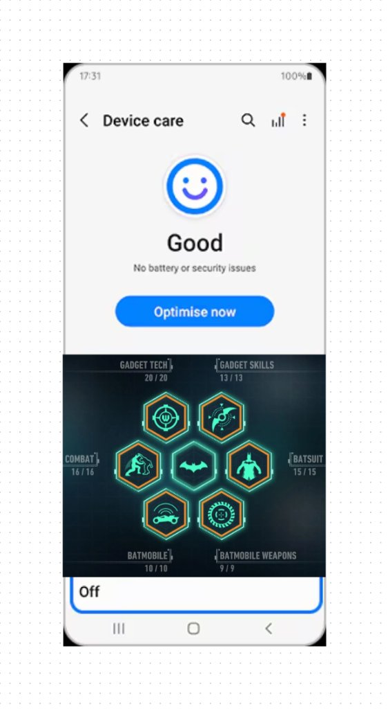

# ISD-Uplink (Android Companion)

## Philosophy & Guiding Principles
* **Hardware First:** The app exists to serve the watch, not steal your attention. You should spend less time in the app than looking at your wrist. Fast in, fast out.
* **Progressive Disclosure:** Surface only the essentials by default. Give access to deep and transparent info on demand, without overwhelming the user in endless text fields.
* **Cold & Silent Execution:** Native Android (Kotlin + Jetpack Compose). No WebViews, no background battery churn, no phone heating.

## Aesthetic & Feel
* **Visual Language:** Preserve the original Uplink aesthetic—deep OLED blacks, sharp industrial amber/orange accents, high contrast, and clean card geometry.
* **Zero Vanity Bloat:** Stripped clean of pseudo-tech jargon, redundant subtitles, and decorative text spam. Pure, functional hardware styling.

## Main Screen Layout Concept
A split two-zone layout designed specifically for one-handed portrait phone use:

### 1. Top Zone: Device Care Overview
* **Header & Quick Search:** Clean top bar with device name, connection badge, and a **Magnifying Glass (Search)** to instantly jump to any setting, sensor, or toggle across the entire app.
* **Dynamic Health Avatar (Watch "Smiley" Status):** An expressive health indicator reflecting real-time watch state:
  * 😊 **Optimal / Good:** All sensors responding (NX-SDS pass), battery healthy, RAM/storage clear.
  * 😐 **Needs Attention:** Update available, long uptime recommending reboot, or high heap usage.
  * 😟 **Warning / Action Needed:** Low battery, MicroSD full, or sensor bus error detected.
* **Instant Health Verdict:** 1-line summary beneath the avatar (e.g., *"All systems nominal"* or *"SD Card 98% full"*).
* **Single Quick Action:** One primary button (**"Optimize / Quick Sync"**) to sync RTC time, clear transient watch caches, and refresh diagnostics in one tap.
* **Zero Clutter:** No live raw telemetry streams or oscilloscopes burning phone battery.

### 2. Bottom Zone: Hexagonal Subsystem Hub
Inspired by tactical weapon/gadget radial menus (Arkham Knight WayneTech style), trimmed down to fit vertical mobile screens comfortably:

* **Center Hexagon (Field Manual & Reference):**
  * Cheatsheet for watch physical controls (3-way lever: Left, Right, Push).
  * Theoretical battery life runtimes by operating profile.
  * Troubleshooting, FAQs, and hardware pinout/spec sheet.

* **Surrounding Hexagons (Functional Gateways):**
  * **General (System & Storage):**
    * **Hardware Link & Provenance (QR Scanner):** Camera scanner to scan the 5x5mm QR code on the PCB bottom (`NX-ISD_v1p4_XXXX`), registering the board serial number, authenticity, and revision.
    * **Battery & Power:** MAX17048 metrics (voltage, SOC %, discharge rate), power profiles, and sleep rules.
    * **Storage & File Explorer:** MicroSD space meter and full file browser (inspect logs, configs, and assets directly on the card).
    * **Firmware Maintenance:** OTA firmware updates and system reboot/reset controls.
  * **Peripherie (Hardware Tuning & Diagnostics):**
    * **NX-SDS Hardware Audit:** Run in-situ self-diagnostics; verify silicon health (RV-3028, MAX17048, BME690, BNO085, MAX30102, MicroSD bus); inspect `/sds/audit_log.txt`.
    * **RTC Timekeeper:** Synchronize RV-3028 clock to phone time; monitor supercapacitor backup status.
    * **Display:** Brightness level and screen sleep timeout.
    * **Buzzer:** Frequency tuning, test beeps, and audio alert volume.
    * **4x4 NeoPixel Matrix:** Pattern selector, custom color designer, and brightness slider.
  * **Notifications (BLE Bridge & Alert Rules):**
    * List of all installed Android apps.
    * Per-app hardware alert rules via two clean toggles:
      * `[x] Allow Buzzer` (audio alert on notification)
      * `[x] Allow NeoPixel Matrix` (visual light pulse/pattern on notification)
  * **Health (Biometrics & Activity):**
    * Historical charts and logs: Heart rate (BPM), SpO2, stress estimations, step counts.
    * Measurement reminder intervals and targets.
