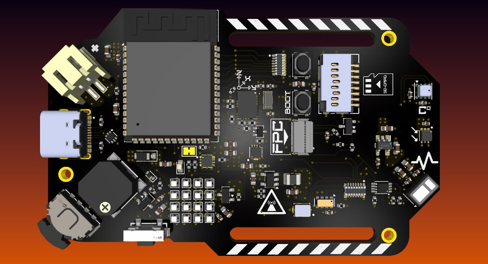
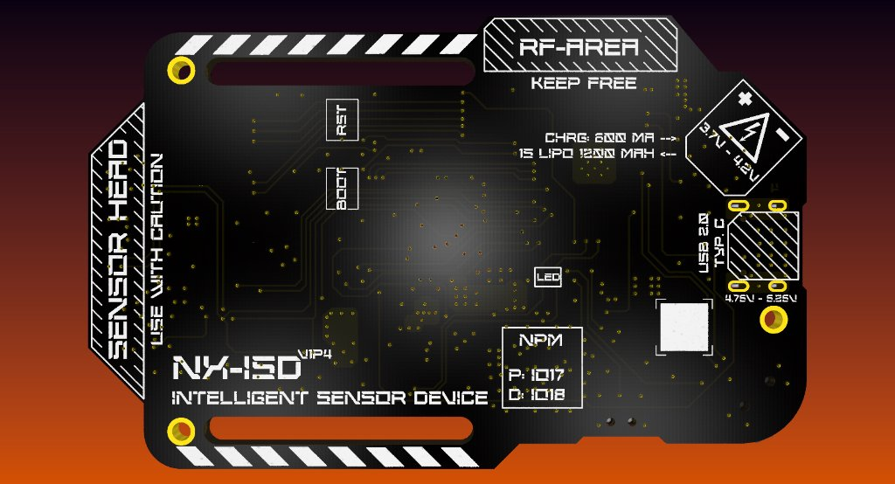
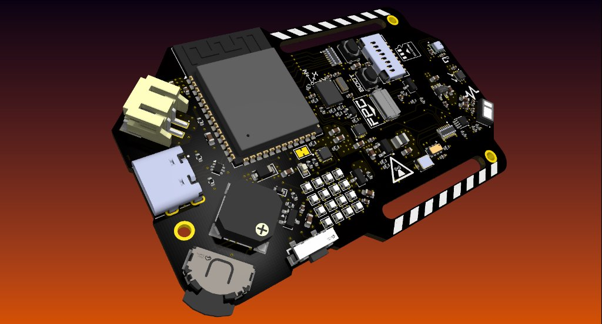
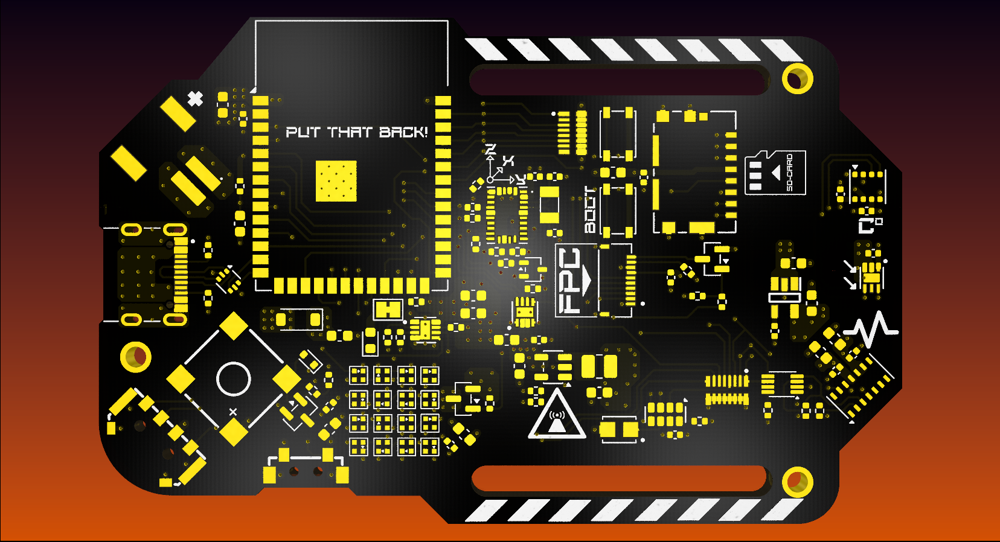

# NX-ISD

## Overview
The **NX-ISD** is a custom, highly integrated wearable and embedded development board inspired by the Artemis Watch. It serves as the hardware foundation for the **ISD-Core** operating system.

> [!TIP]
> **Active Production Milestone — Hardware Revision v1.4 (Current & Recommended):**  
> Revision **v1.4** is the active, production-ready hardware milestone featuring an integrated rechargeable supercapacitor for continuous RTC timekeeping, high-speed 4-bit SDMMC MicroSD storage, a direct 40 MHz 3.3V SPI display bus (TXB0106 level shifter eliminated), tactile BOOT/RST buttons, enhanced copper heatsinking, and a cyberpunk industrial silkscreen aesthetic.  
> 📦 **Fabrication Package (Gerbers & Drill):** [`ISD-PCB/NX-ISD_v1p4/production/NX-ISD_v1p4.zip`](ISD-PCB/NX-ISD_v1p4/production/NX-ISD_v1p4.zip)  
> 📜 **Complete 5-Page Circuit Diagram:** [`docs/circuit diagrams/NX-ISD_v1p4.pdf`](docs/circuit%20diagrams/NX-ISD_v1p4.pdf)  
> 🏭 **Fabrication & Ordering Guide:** [`ISD-PCB/PRODUCTION-GUIDE.md`](ISD-PCB/PRODUCTION-GUIDE.md)

<p align="center">
  
  
</p>
<p align="center">
  
  
</p>
<p align="center">
  <em>NX-ISD Hardware Revision v1p4 (KiCad Raytraced 3D Renders) — Populated Top View, Bottom Silkscreen, Perspective Isometric Angle, and Bare ENIG Finish.</em>
</p>

## Naming & Structure

```text
N X - I S D
│     │
│     └─► Intelligent Sensor Device (Hardware Foundation)
│           │
│           ▼
│       ISD-Core
│           │
│           ├─► Custom Operating System (Dual-Core FreeRTOS based)
│           ├─► Built on PlatformIO / Arduino Framework
│           │
│           ├──► NX-MSF: Mathematical Sensor Fusion (Physics Models & Kalman Filters)
│           ├──► NX-AIS: Advanced Information System (Contextual Advisory Engine)
│           └──► NX-SDS: Self-Diagnostic System (Hardware Integrity & Proof-Testing)
│
└─► Prototyping Series (Continuous Development Environment)
```

* **Hardware Lineage:** Originally inspired by and iterated from the [Artemis Watch](https://circuitmess.com/products/nasa-artemis-watch) (and subsequently the [Artemis Watch 2.0](https://circuitmess.com/products/nasa-artemis-watch-2-0)) by CircuitMess, heavily expanded into a custom tactical multi-sensor wearable.
* **The "NX" Philosophy:** Inspired by Starfleet's experimental registry designation ([Memory Alpha: NX](https://memory-alpha.fandom.com/wiki/NX)), the **NX** prefix denotes an active, pioneering prototyping environment. Rather than static consumer electronics, each build is a working experimental platform. Once a revision is tagged and published, that milestone is locked in history—quirks, bugs, and all:
  * **Revision v1.4 (Current & Recommended):** Production revision with MicroSD (4-bit SDMMC), supercapacitor RTC backup, direct 40 MHz SPI display bus, and physical RST/BOOT buttons. [`ISD-PCB/NX-ISD_v1p4/`](ISD-PCB/NX-ISD_v1p4/)
  * **Revision v1.3 (Prototype Carrier):** First operational wearable prototype assembly with NAND flash and TXB0106 display shifter. [`ISD-PCB/NX-ISD_v1p3/`](ISD-PCB/NX-ISD_v1p3/)
  * **Revision v1.0 (Initial Prototype Archive):** The original, raw starting schematics, early layout, and BOM preserved for historical nostalgia, open-source transparency, and post-mortem analysis. [`ISD-PCB/NX-ISD_v1p0/`](ISD-PCB/NX-ISD_v1p0/)

## Hardware Specifications (Revision v1.4)

### Core & Storage
* **Microcontroller:** ESP32-S3-WROOM-1-N16R8 (Dual-Core Xtensa LX7 @ 240MHz, 16MB Quad-SPI Flash, 8MB Octal PSRAM)
* **High-Speed Mass Storage:** MicroSD Card Slot (`J4`, Molex 105162-0001) operating in 4-bit SDMMC bus mode via the ESP32-S3 GPIO Matrix (`SD_CLK` IO41, `SD_CMD` IO43, `SD_DAT0` IO44, `SD_DAT1` IO42, `SD_DAT2` IO1, `SD_DAT3` IO2)

### Sensors & Biometrics
* **Motion / 9-DOF IMU:** BNO085 (CEVA / Hillcrest Labs AR/VR Motion Co-Processor with dedicated 32.768 kHz crystal `Y1`)
* **Environment:** BME680 / BME690 (Bosch Sensortec Gas MOX, Barometric Pressure, Relative Humidity, Temperature)
* **Ambient Light:** OPT3001DNPR (Texas Instruments Precision Photopic Lux Sensor)
* **Biometrics / PPG:** MAX30102 (Pulse Oximetry $SpO_2$ & Heart-Rate Biosensor, isolated on 1.8V domain via PCA9306DCKR bidirectional level shifter `U9`)
* **Precision Timing & RTC:** RV-3028-C7 (Micro Crystal Switzerland, 45 nA typ.) backed by an integrated **11 mF 3.3V Seiko `CPH3225A` rechargeable supercapacitor (`C5`)** charged via internal silicon trickle charger (~6.2 days continuous autonomous timekeeping)

### Power Management & Thermal Design
* **Battery Charging:** USB-C (BQ25170 Linear LiPo Charger configured for 600mA charging into 1S 1200mAh LiPo; enhanced bottom GND thermal relief plating)
* **Fuel Gauge:** MAX17048G_T10 (ModelGauge™ cell voltage tracking, state-of-charge %, and `!ALERT` interrupt line)
* **System Rail (+3V3):** TLV62568 Synchronous Step-Down Buck Converter (1A rating, ~95% efficiency, 2.2µH power inductor)
* **Sensor Rail (+1V8):** RT9193-18GB Ultra-Low-Noise LDO (300mA rating, dedicated clean analog rail for MAX30102 core)
* **Power-Path & Switches:** High-efficiency `DMP3130L-7` P-MOSFETs for USB/Battery power-path management and NeoPixel sleep cutoff; `ZXMN3B14FTA` 30V N-MOSFETs for acoustic buzzer and display backlight control

### Peripherals & User Interaction
* **Display Interface:** [1.54" 240×240 IPS Color TFT (ST7789V2)](https://de.aliexpress.com/item/1005007654038756.html) connected via 10-pin 0.5mm dual-contact FPC connector (`J3`). Operates natively on a **direct 3.3V SPI bus at 40 MHz** (TXB0106 level shifter eliminated for rock-solid signal integrity)
* **Optical Matrix:** 16x NeoPixel 4×4 Serpentine RGB Matrix (XL-1010RGBC-WS2812B) with zero-leakage PMOS high-side power gate (`IO17` enable, `IO18` data) and local decoupling capacitors
* **Acoustic Transducer:** 16Ω Electromagnetic SMT Buzzer (`SMD-8503-3627-16Ω`) with flyback diode protection
* **Input Controls:**
  * Multi-Directional Navigation Lever-Switch (`TM-2025A` 5-way navigation: Up, Down, Left, Right, Center Push)
  * Main Tactical User Push-Button with hardware pull-up for deep-sleep wake
  * Dedicated Tactile **BOOT** (`SW2`) and **RST** (`SW1`) Micro Push-Buttons for effortless flashing and recovery

## Software & Core Systems
The board is programmed via **PlatformIO** (Arduino Framework) and is optimized to run the custom **ISD-Core** operating system. The software stack is composed of core modular subsystems:

* **[ISD-Core](ISD-Core/):** The dual-core FreeRTOS operating system handling task scheduling (Core 1 UI @ ~42Hz, Core 0 Sensors @ 50Hz/1Hz), thread-safe `SensorState` telemetry, 3D Cover Flow launcher, 360° radial dials, and smoothstep backlight transitions. See [`ISD-Core/README.md`](ISD-Core/README.md) for the software architecture and [`ISD-Core/MANUAL.md`](ISD-Core/MANUAL.md) for the complete user manual.
* **Persistent Storage Subsystem (`StorageManager`):** Manages non-volatile configuration storage, sensor logs, and system data on high-speed MicroSD storage (`4-bit SDMMC` mode on v1.4 hardware; SPI NAND on legacy v1.3 prototype). Stores a 64-byte packed binary struct (`/sys/config.bin`) with CRC-16 validation and a zero-wear save policy (writes occur only on user confirmation/exit, never while dialing).
* **Unified Host CLI & Config Engine (`tools/isd_cli.py` / `isd-cli`):** Standalone PC terminal tool providing blind navigation control, live sensor monitoring, BLE Uplink Bridge triggering, and offline `/sys/config.bin` binary inspection, verification, and JSON conversion.
* **NX-MSF (Mathematical Sensor Fusion):** The analytical physics and math engine executing 1D Kalman filter variometer tracking, Magnus-Tetens dew point calculation, barometric storm gradients, RMSSD heart rate variability, and software energy accounting.
* **NX-AIS (Advanced Information System):** The autonomous on-device contextual advisor translating raw multi-sensor telemetry into proactive health, environmental, and tactical notifications.
* **NX-SDS (Self-Diagnostic System):** The internal hardware integrity and health assurance engine providing continuous I2C bus recovery, on-demand in-situ proof-testing, and predictive battery/sensor aging analytics.

## Documentation & Manuals
* **Hardware Production & Fabrication Guide:** [`ISD-PCB/PRODUCTION-GUIDE.md`](ISD-PCB/PRODUCTION-GUIDE.md) — Complete JLCPCB ordering parameters, mechanical drawings/dimensions, stencil specs, and hand assembly workflow.
* **Fabrication Packages (Gerbers):** [`ISD-PCB/NX-ISD_v1p4/production/NX-ISD_v1p4.zip`](ISD-PCB/NX-ISD_v1p4/production/NX-ISD_v1p4.zip) — Ready-to-order RS-274X Gerbers and drill files for revision v1.4.
* **Interactive HTML BOM (Visual Assembly Tool):** [`ISD-PCB/NX-ISD_v1p4/bom/NX-ISD_v1p4_IBOM.html`](ISD-PCB/NX-ISD_v1p4/bom/NX-ISD_v1p4_IBOM.html) — Interactive visual assembly BOM highlighting components and pads.
* **User & Navigation Manual:** [`ISD-Core/MANUAL.md`](ISD-Core/MANUAL.md) — Comprehensive guide covering physical controls, screen layouts, the 6 core application decks, 360° radial dials, and storage persistence.
* **Architecture & Hardware Guide:** [`ISD-Core/README.md`](ISD-Core/README.md) — Technical operating system internals, pin maps, and PlatformIO build instructions.
* **Hardware & PCB Specifications:** [`ISD-PCB/README.md`](ISD-PCB/README.md) — Hardware schematics, power budgets, layer stackup, and BOM.
* **Features & Math Modeling Roadmap:** [`FEATURE_LIST.md`](FEATURE_LIST.md) — Technical specifications, mathematical formulas, and implementation roadmap.
* **Software Roadmap & TODOs:** [`ISD-Core/SW-TODO.md`](ISD-Core/SW-TODO.md) — Core application deck progress and feature checklist.

## AI Collaboration & Transparency Disclaimer
In the spirit of full open-source transparency:
* **AI Assistance:** Generative AI pair-programming tools were used to assist with documentation drafting, software architecture refinement, mathematical formula translations, and repository organization.
* **Engineering & Ownership:** All hardware schematics, PCB routing, component selection, electrical calculations, physical assembly, and system verification remain 100% human-engineered, tested, and maintained by the author ([@Ghost3379](https://github.com/Ghost3379)).

## License
The software/firmware in the [ISD-Core] directory is licensed under the GNU General Public License v3.0 (GPLv3).

The hardware design files in the [ISD-PCB] directory are licensed under the CERN Open Hardware Licence Version 2 - Strongly Reciprocal (CERN-OHL-S).
